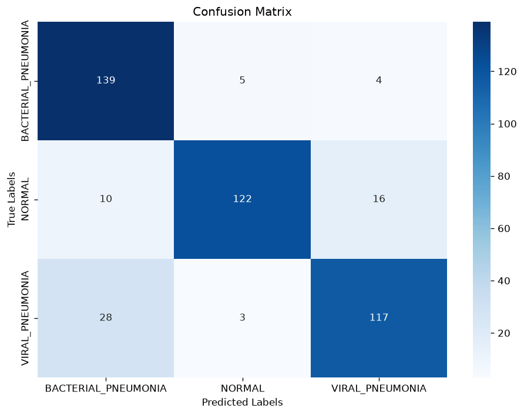
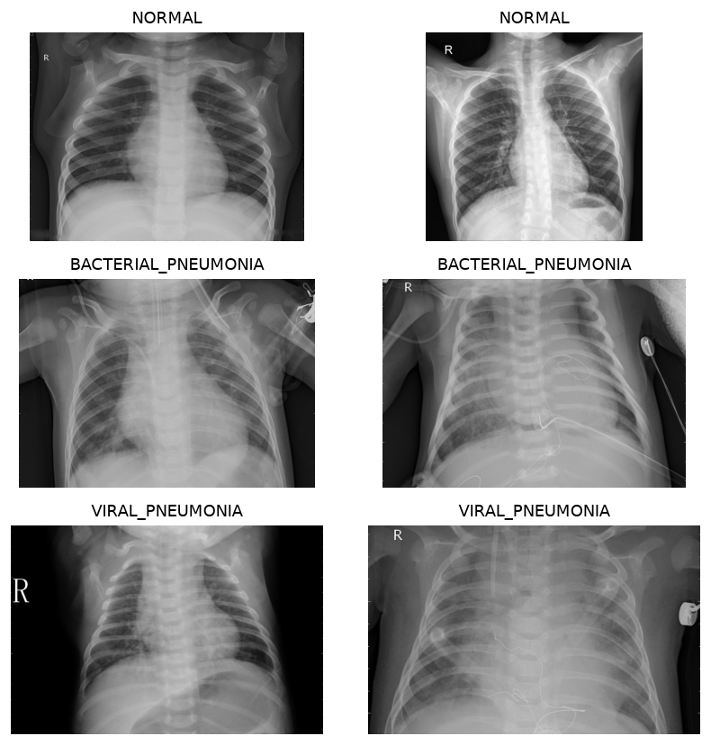
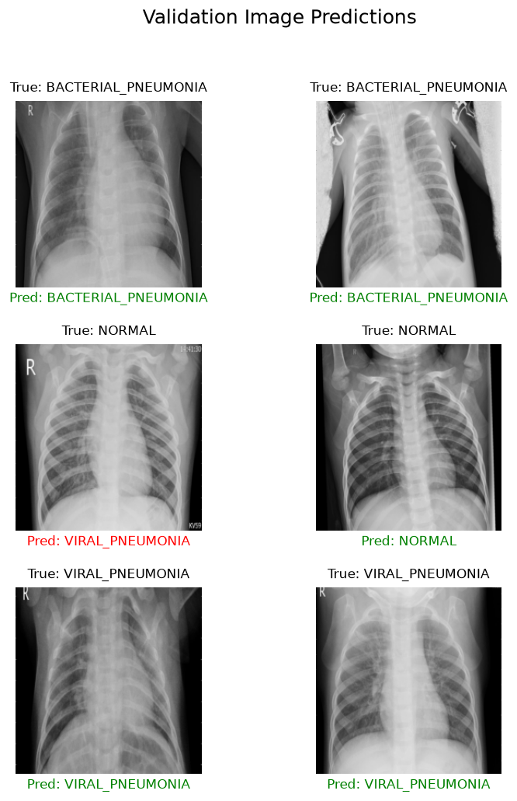
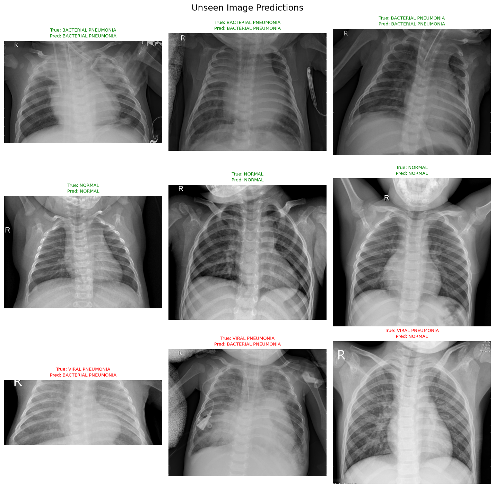

# Pneumonia Diagnostic Assistant

A deep-learning project that classifies chest X-ray images into **Bacterial Pneumonia**, **Normal**, and **Viral Pneumonia** using **ResNet-18 transfer learning**, PyTorch, and PyTorch Lightning.

> **Medical disclaimer:** This project is for educational and experimental purposes only. It is not a medical device, is not intended for clinical diagnosis, and must not be used to make treatment decisions.

## Overview

The repository contains a notebook-based workflow and a Python script for dataset preparation, model setup, training, validation, class-wise evaluation, confusion-matrix generation, and example predictions.

### Tech stack

- Python
- PyTorch and Torchvision
- PyTorch Lightning
- TorchMetrics
- NumPy, Matplotlib, and Seaborn
- Pillow and tqdm

## Reported Results

The metrics below are recorded in [`results_report.md`](results_report.md).

| Metric | Reported result |
|---|---:|
| Training images | 4,014 |
| Validation images | 444 |
| Final validation accuracy | **85.14%** |
| Final validation loss | **0.4413** |
| Bacterial pneumonia class accuracy | **93.92%** |
| Normal class accuracy | **82.43%** |
| Viral pneumonia class accuracy | **79.05%** |
| Unseen-image sample | **6/9 correct (66.67%)** |

The training split has 1,338 images per class, and the validation split has 148 images per class.

### Class-wise accuracy

| Class | Accuracy |
|---|---:|
| `BACTERIAL_PNEUMONIA` | 93.92% |
| `NORMAL` | 82.43% |
| `VIRAL_PNEUMONIA` | 79.05% |

The nine-image unseen sample is small and should not be treated as a robust independent benchmark. In the reported sample, all three viral pneumonia examples were misclassified. Validation-set metrics and unseen-image results represent different evaluations.

## Results and Visualizations

### Confusion matrix



### Example training images



### Validation predictions



### Unseen-image predictions



See [`results_report.md`](results_report.md) for detailed metrics and the table of all nine unseen-image predictions.

## Repository Structure

```text
Pneumonia-Diagnostic-Assistant/
├── C2M4_Assignment.ipynb   # Main notebook / assignment workflow
├── run_notebook.py         # Scripted training and evaluation workflow
├── helper_utils.py         # Dataset, evaluation, and visualization helpers
├── unittests.py            # Unit-test definitions
├── unittests_utils.py      # Test utilities
├── results_report.md       # Detailed results and interpretation
└── results/
    ├── 1_random_training_images.png
    ├── 2_confusion_matrix.png
    ├── 3_validation_predictions.png
    └── 4_unseen_predictions.png
```

The chest X-ray dataset and pretrained model weights referenced by the workflow are not included in the repository's root file listing. These assets must be obtained separately and placed at the paths expected by the scripts before running the complete workflow.

## Setup

Create and activate a virtual environment:

```bash
git clone https://github.com/Shubham-4427/Pneumonia-Diagnostic-Assistant.git
cd Pneumonia-Diagnostic-Assistant
python -m venv .venv
```

**macOS / Linux**

```bash
source .venv/bin/activate
```

**Windows PowerShell**

```powershell
.venv\Scripts\Activate.ps1
```

Install the packages used by the workflow:

```bash
python -m pip install --upgrade pip
python -m pip install torch torchvision lightning torchmetrics numpy matplotlib seaborn pillow tqdm jupyter
```

> **Environment note:** The repository does not currently include a pinned dependency file, so this command does not lock package versions. GPU acceleration and package compatibility vary by operating system. Prefer a course- or lab-provided environment if one is available.

## Dataset and Model Weights

The notebook and script expect the dataset under `./chest_xray/`, with `train/` and `val/` directories containing the three class folders:

```text
chest_xray/
├── train/
│   ├── BACTERIAL_PNEUMONIA/
│   ├── NORMAL/
│   └── VIRAL_PNEUMONIA/
└── val/
    ├── BACTERIAL_PNEUMONIA/
    ├── NORMAL/
    └── VIRAL_PNEUMONIA/
```

The evaluation workflow also references an `./unseen/` directory organized by class. The notebook references pretrained weights at `./resnet18_chest_xray_classifier_weights.pth`.

Use only datasets and weights you are authorized to access. The full project will not run until the expected assets are available at the required paths.

## Running the Project

### Run the notebook

Launch Jupyter from the repository root:

```bash
jupyter lab
```

Open `C2M4_Assignment.ipynb` and run the cells in order.

### Run the Python script

After placing the required dataset and pretrained weights in the expected locations:

```bash
python run_notebook.py
```

The script is configured to write generated visualizations to `./results/`. Review its configuration and file paths before running it in a new environment.

## Training Configuration in the Results Report

| Setting | Value |
|---|---:|
| Maximum epochs | 10 |
| Early-stopping validation-accuracy target | 85% |
| Learning rate | 0.001 |
| Weight decay | 0.01 |
| Optimizer | AdamW |
| Scheduler | ReduceLROnPlateau |
| Precision | 16-bit mixed precision (AMP) |
| Batch size | 64 |
| Random seed | 15 |

The report states that training completed after one epoch because the validation-accuracy stopping threshold was met. This describes the recorded run; it does not establish reliable generalization to other datasets or clinical settings.

## Testing

The notebook includes test cells for the data module, classifier module, early-stopping configuration, and training function. Run the relevant cells in an environment with the assignment dependencies and required data available.

## Limitations

- Results are reported for a specific validation split and a very small unseen-image sample.
- Viral pneumonia has the lowest class-wise accuracy in the reported results.
- These metrics do not establish clinical readiness, external-site performance, fairness across populations, or model calibration.
- The dataset and pretrained weights must be sourced and configured separately.
- A pinned dependency file and a license file were not present in the repository listing when this README was prepared.

## Project Files

- [Main notebook](C2M4_Assignment.ipynb)
- [Detailed results report](results_report.md)
- [Python workflow](run_notebook.py)

## License

No license file was present in the repository listing when this README was prepared. Add a license file if you want to specify permissions for using, modifying, and redistributing this project.

---

Built for educational exploration of deep learning and medical-image classification.
